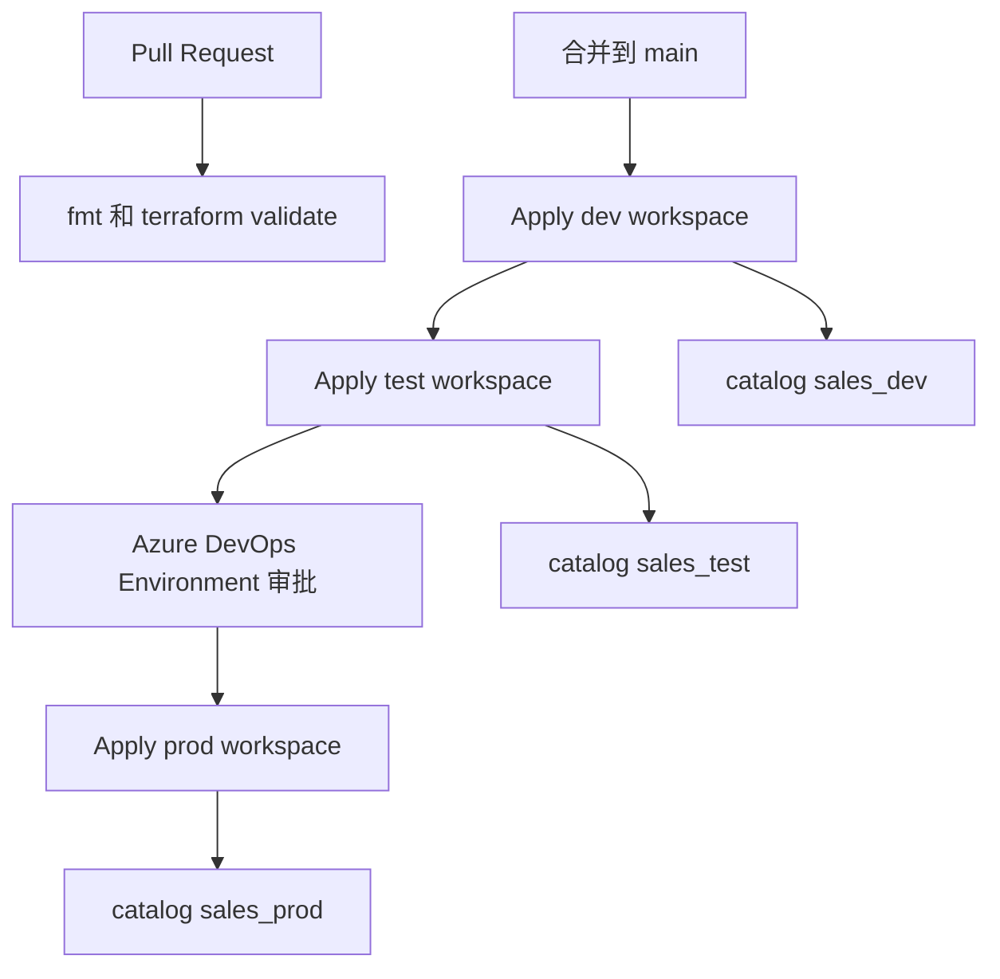

# Databricks 多环境 Terraform（dev / test / prod）

三个 Azure Databricks workspace，一套 Terraform。Azure DevOps 按环境套用不同的 `tfvars` 和不同的 state 文件，catalog、schema、表、job、schedule 的**定义**只写一次。

本目录是可以单独放进 GitHub 的骨架。当前仓库里的 `pipeline/`、`dataset/`、`trigger/` 是 Azure Data Factory，和这里无关。

## 结论

可以，而且这是 Databricks 在同一区域里的推荐拆法：

| 对象 | 作用域 | 三个环境能否同名 | 本仓库怎么做 |
| --- | --- | --- | --- |
| Workspace | Azure 资源 | 名称可以相同，资源 ID 必须不同 | 平台组先建好。本目录不创建 workspace |
| Metastore | 区域级，一个区域一个 | 不按环境拆 | dev、test、prod 三个 workspace 挂同一个 metastore |
| Catalog | Metastore 内全局唯一 | 不能三个都叫 `sales` | `sales_dev`、`sales_test`、`sales_prod` |
| Schema | Catalog 内唯一 | 可以都叫 `silver` | 同一份列表：`bronze`、`silver`、`gold` |
| Table | Schema 内唯一 | 可以都叫 `orders` | 定义在 `live/locals.tf`，只写一次 |
| Job | Workspace 内唯一 | 可以都叫 `load_orders` | 模块参数 `job_name` 固定 |
| Schedule | 挂在 job 上 | cron 可以相同 | 同一条 `0 0 6 * * ?`。dev/test 为 `PAUSED`，prod 为 `UNPAUSED` |

Catalog 是唯一必须带环境后缀的名字。因为 Unity Catalog 的 catalog 属于 metastore，不属于某一个 workspace。三个 workspace 共用一个 metastore 时，不能有三个都叫 `sales` 的 catalog。

Schema、表、job 的名字保持一样。笔记本里不要写死 catalog，读 job 传进来的参数：

```text
sales_dev.silver.orders
sales_test.silver.orders
sales_prod.silver.orders
```

如果业务上要求 catalog 也叫同一个名字（三个环境都是 `sales`），只能给每个环境单独一个 metastore。同一区域不建议这么做。官方建议是一个区域一个 metastore，用 catalog 隔离环境，并把 catalog 设成 `ISOLATED`，只绑定自己的 workspace。

## 部署流



每个环境一份 Terraform state。dev 的 apply 读不到 prod 的资源，也不会去改它。

```text
sttfstatedatabricks / tfstate / databricks/dev.tfstate
sttfstatedatabricks / tfstate / databricks/test.tfstate
sttfstatedatabricks / tfstate / databricks/prod.tfstate
```

## 目录

```text
databricks-platform/
  live/                          唯一的根模块，三个环境共用
    versions.tf                  Terraform 与 provider 版本，azurerm 远程状态
    providers.tf                 指向「当前环境」的 workspace
    variables.tf                 环境之间允许不同的输入
    locals.tf                    schema 名和表结构，只写一次
    main.tf                      把三个模块串起来
    outputs.tf
    envs/
      dev.tfvars                 只放环境差异
      test.tfvars
      prod.tfvars
      dev.backend.hcl            state 的 key
      test.backend.hcl
      prod.backend.hcl
  modules/
    unity_catalog/               catalog、schema、授权、隔离
    tables/                      托管表
    job/                         多任务 job 和一条 schedule
  src/notebooks/load_orders.py   job 从 Git 拉取的笔记本
  pipelines/
    azure-pipelines.yml          dev -> test -> prod
    steps-terraform.yml
```

新增一张表时，只改 `live/locals.tf`。三个环境下一次 apply 会各自在自己的 catalog 里建同名表。

新增一个业务域时，复制一份 `live/` 的调用（或再加一个 `domain` 的 module 调用），不要复制 `modules/`。

## 各文件在管什么

### `live/providers.tf`

用 `azure_workspace_resource_id` 选定 workspace。流水线换的是这个 ID，不是另一套 Terraform 代码。

认证不进 Git。Azure DevOps 的 `AzureCLI@2` 加上 `addSpnToEnvironment: true` 后，会注入：

```text
ARM_CLIENT_ID
ARM_CLIENT_SECRET
ARM_TENANT_ID
ARM_SUBSCRIPTION_ID
```

Databricks provider 用这组变量向该 workspace 要 token。不要在仓库里放 PAT，也不要把 client secret 写进 tfvars。

### `modules/unity_catalog`

- catalog 名 = `<domain>_<environment>`
- `isolation_mode = "ISOLATED"`：从 dev workspace 创建的 catalog 只绑定 dev。test、prod 同理，因为它们的 state 和 workspace 是另一套
- schema 用 `for_each` 按同一份名字创建
- `databricks_grants` 是覆盖式的。这个 catalog 上的权限以代码为准，在界面上加的授权下次 apply 会被去掉。每个对象只留一份 `databricks_grants`

Catalog 上的 `USE_SCHEMA`、`SELECT`、`MODIFY` 会继承到下面的 schema 和表。

### `modules/tables`

`databricks_sql_table` 建托管表。列定义在 `live/locals.tf`。

改列类型会强制删表重建，生产上不要靠 Terraform 做日常加列。加列、回填走笔记本或迁移工具，Terraform 只负责第一版结构。

`warehouse_id` 为空时，provider 会临时拉起一个叫 `terraform-sql-table` 的集群来执行建表 SQL。每个环境准备一个小 SQL Warehouse，把 ID 填进 tfvars，可以避免这件事。

### `modules/job`

- job 名三个 workspace 相同
- 一条 `schedule` 覆盖整条 job。任务用 `depends_on` 串联：`bronze_to_silver` 然后 `silver_to_gold`
- cron 用 Quartz，不是 Linux cron。`0 0 6 * * ?` 表示每天 06:00，时区 `Asia/Shanghai`
- `pause_status`：dev 和 test 是 `PAUSED`，定义在、但不会自动跑。prod 是 `UNPAUSED`
- `git_source` 让 job 直接跑仓库里的笔记本。dev 跟踪 `develop`，test 跟踪 `release`，prod 跟踪 `main`。笔记本路径三个环境相同
- `run_as` 和集群的 `single_user_name` 都是 job runner 服务主体的 Application ID。Unity Catalog 的 `SINGLE_USER` 集群要求这两个一致
- catalog 通过 `base_parameters` 传进笔记本，代码里用 `dbutils.widgets.get("catalog")`

### `pipelines/azure-pipelines.yml`

| 阶段 | 何时跑 | Azure DevOps Environment |
| --- | --- | --- |
| Validate | 每次 PR 和 main | 无 |
| Dev | 仅 main 上的合并 | `databricks-dev` |
| Test | dev 成功之后 | `databricks-test` |
| Prod | test 成功之后 | `databricks-prod` |

PR 只做 `terraform fmt -check` 和 `terraform validate`，不 apply。

Prod 的人工审批加在 Environment `databricks-prod` 的 Approvals check 上，不要写进 YAML。批准之前不会对 prod workspace 做 apply。

三个 workspace 如果在不同订阅，把 `serviceConnection` 拆成三条 service connection，分别传给对应 stage。Service connection 名字必须在 YAML 里是编译期就能确定的字符串。

## 第一次落地

下面这些对象先于 Terraform 存在。它们变化少，可以由平台组手工建，或放到另一份「平台」state 里。不要和每天都在改的表、job 放在同一份 state。

1. 该区域一个 Unity Catalog metastore，dev、test、prod 三个 workspace 都 assign 到它上面。
2. 三个 workspace。本目录假设它们已经存在。
3. 一个给流水线用的服务主体，加进每个 workspace，并在 metastore 上拥有 `CREATE CATALOG`。三个环境可以用同一个主体，只要它同时是三个 workspace 的管理员或有同等权限。
4. 一个专门跑 job 的服务主体（Application ID 填进 `job_runner_application_id`）。它要在每个 workspace 里存在，并允许被设置成 job 的 run as。
5. 账号级组：`sales-engineers-<env>`、`sales-analysts-<env>`。
6. 每个环境自己的 ADLS Gen2 容器、Access Connector、storage credential、external location。然后把 `storage_root` 写成该环境的 `abfss://` 路径。留空只能用来第一次试验，正式环境必须分开，否则三个 catalog 的托管表会堆在 metastore 的同一根路径下。
7. 一块远程状态用的存储账号。流水线主体需要该存储账号上的 `Storage Blob Data Contributor`。`use_azuread_auth = true`，不要用账号密钥。
8. 在 Azure DevOps 创建 Environment：`databricks-dev`、`databricks-test`、`databricks-prod`。给 prod 加上 Approval。
9. 创建 service connection（工作负载身份联合或服务主体），名字改成 YAML 里的 `sc-azure-databricks`。
10. 把 `live/envs/*.tfvars` 里的 workspace 资源 ID、组名、Application ID、Git 地址、Runtime 版本换成实际值。Runtime 用 workspace 里现有的 LTS，示例里的 `15.4.x-scala2.12` 只是占位。
11. Databricks 里把 Git 凭据配到 job runner 能读到的仓库。仓库如果在 Azure Repos，把 `git_provider` 改成 `azureDevOpsServices`。

本地查看某个环境的计划：

```bash
cd databricks-platform
make init ENV=dev
make plan ENV=dev
```

先登录 Azure CLI，并且当前身份要能访问 dev workspace 和 state 存储账号。

## 不要做的事

- 不要为 dev、test、prod 复制三份 `main.tf`。环境差异只留在 `envs/*.tfvars` 和 `envs/*.backend.hcl`。
- 不要三个环境共用一个 state 文件。
- 不要在 prod 把 `force_destroy` 设为 `true`。
- 不要把 client secret、PAT、存储账号密钥提交进 Git。tfvars 里可以有 workspace 资源 ID 和组名。
- 不要从 dev 的流水线去创建 prod 的 catalog。隔离模式只认「创建它所在的那个 workspace」。
- 不要用 Terraform 管理高频变化的列级演进。表的日常变更放在笔记本或迁移脚本里。

## 和 Azure Data Factory 的边界

ADF 的 pipeline、dataset、trigger 继续走现在的发布方式。Databricks 的 catalog、表和 job 走本目录。两边不要塞进同一份 Terraform state，也不要共用同一条 Azure DevOps stage。ADF 只负责把数据送到存储；Databricks job 负责从 bronze 加工到 silver / gold。
